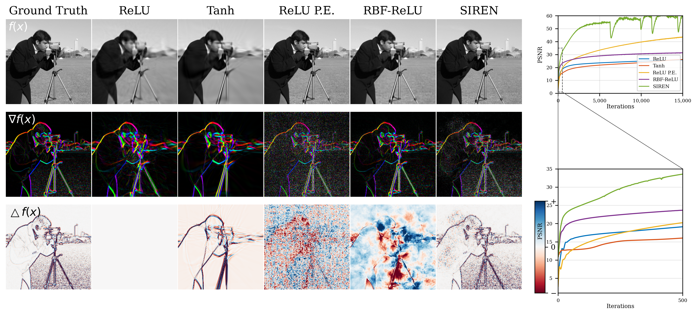
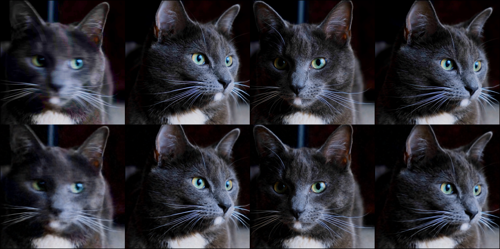
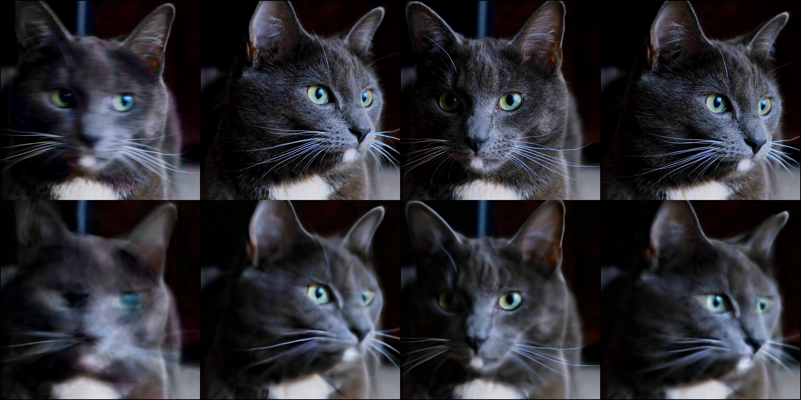
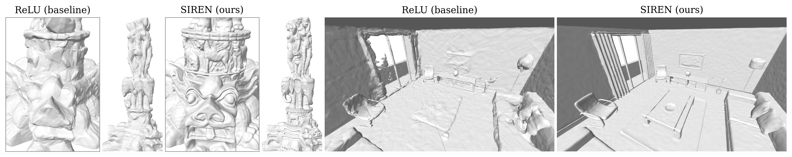
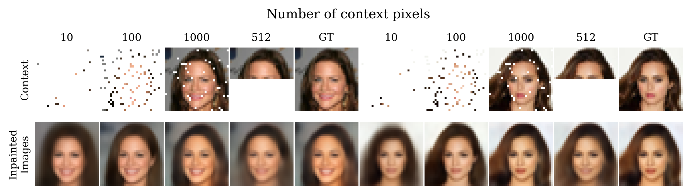
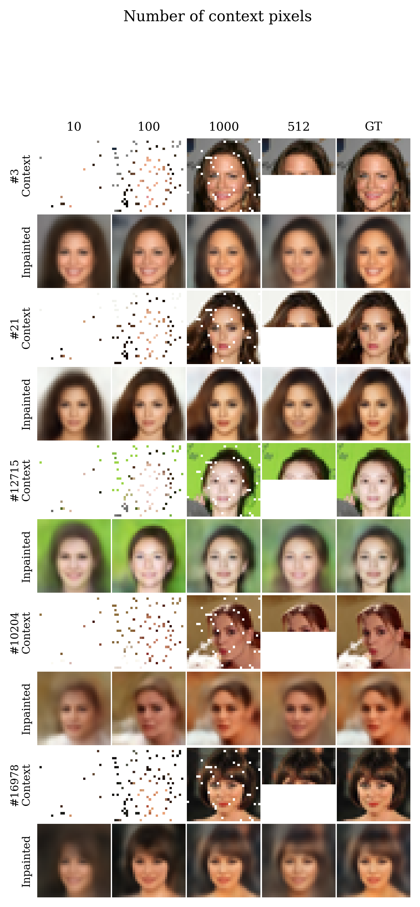

# SIREN Reproduction on Google Colab

A reproduction of **Implicit Neural Representations with Periodic Activation Functions** (SIREN, Sitzmann et al., NeurIPS 2020) using the [official code](https://github.com/vsitzmann/siren), run end to end on Google Colab.

Reproduced so far: image fitting (Fig. 1), video fitting (Fig. 2), Poisson image reconstruction and editing (Fig. 3), shape representation with signed distance functions (Fig. 4), and generalization by image inpainting on CelebA (Fig. 6). The Helmholtz experiments (Fig. 5) are still running. Training used the official scripts and their default settings; every change needed to run them on Colab is listed under [Deviations from the official setup](#deviations-from-the-official-setup).

## Results

### Fig. 1 — Image fitting

Five architectures fit the 256 × 256 cameraman image for 15,000 iterations (Adam, learning rate 1e-4): ReLU, Tanh, ReLU with positional encoding, RBF-ReLU and SIREN. Left: the reconstruction, its gradient and its Laplacian at the end of training. Right: PSNR at every iteration over the whole run and over the first 500 iterations. SIREN reproduces both the image and its derivatives; the baselines lose fine detail and produce noisy or empty second derivatives, as in the paper.



PSNR, mean over the last 1,000 iterations (paper values read from its plot):

| Model | Ours (dB) | Paper (dB) |
|---|---|---|
| ReLU | 25.8 | ≈ 25 |
| Tanh | 26.0 | ≈ 25 |
| ReLU P.E. | 43.2 | ≈ 40 |
| RBF-ReLU | 31.3 | ≈ 28 |
| SIREN | 56.7 | ≈ 50 |

The four baselines end close to the paper. SIREN goes higher (56.7 dB): after about 6,000 iterations it mostly stays between 55 and 60 dB, where the error is so small (MSE around 1e-6) that Adam becomes unstable from time to time. The PSNR then drops sharply and recovers within a few hundred iterations. The paper's curve stays near 50 dB and shows no such drops. The curves are plotted unsmoothed, as logged.

PSNR is computed at every iteration from the logged training loss (the MSE of the image in [-1, 1]): PSNR = 10 log10(4 / MSE). The official `write_psnr`, logged every 500 iterations, first clips the prediction to [0, 1]; both agree closely.

### Fig. 2 — Video fitting

SIREN and a ReLU MLP fit the cat video (512 × 512, 300 frames) with the official defaults (100,000 epochs). Final training PSNR:

| Model | Ours (dB) | Paper (dB) |
|---|---|---|
| SIREN | 32.07 | 29.90 |
| ReLU | 25.36 | 25.12 |

SIREN beats ReLU by a margin close to the paper's.

**SIREN** (top: ground truth, bottom: prediction)



**ReLU** (top: ground truth, bottom: prediction)



### Fig. 3 — Poisson image reconstruction and editing

Left: a SIREN supervised only by the image's gradients (Fitting ∇f) or only by its Laplacian (Fitting Δf); the green bar marks the supervised quantity. Right: the gradients of two images are averaged and a SIREN fits the composite gradients. All panels are the images written by the official TensorBoard summary functions, placed in the paper's layout.


### Fig. 4 — Shape representation (SDF)

SDFs fitted directly on oriented point clouds of the Thai statue and a living room, meshes extracted at 1600³. Left: close-up and full view of the statue. Right: the room. ReLU and SIREN are rendered with identical cameras and lighting. SIREN recovers the carved faces and the furniture; ReLU produces blobby, faceted surfaces.



### Fig. 6 — Generalization: image inpainting on CelebA

A SIREN can also be predicted instead of fitted. A convolutional encoder maps the observed (context) pixels of a 32 × 32 CelebA face to a latent code, and a hypernetwork maps that code to the weights of a SIREN that represents the whole image. The model is trained once on the 162,770 training images and then completes unseen test faces from 10, 100 or 1,000 random pixels, or from the top half of the image (512 pixels).

Top row: the pixels given to the model (white = not given). Bottom row: the image produced by the predicted SIREN. In the GT column, the top is the ground truth and the bottom is the reconstruction from all 1,024 pixels. The paper does not say which faces it shows, so we use test images 3 and 21.



Mean squared error over the 19,962 test images (official `test_conv_neural_process.py`), compared with the "CNN Encoder + Hypernet." row of the paper's Table 4:

| Context pixels | 10 | 100 | 1000 | 512 (half) | 1024 (full) |
|---|---|---|---|---|---|
| Paper | 0.033 | 0.009 | 0.008 | 0.020 | 0.008 |
| Ours | 0.0327 | 0.0098 | 0.0101 | 0.0207 | 0.0109 |

10, 100 and half-image context match the paper. 1000 pixels and the full image are worse because the official training script samples 10–200 context pixels per image, while the supplement trains the convolutional encoder with 10–1000 (see [Deviations](#deviations-from-the-official-setup)); our model never saw more than 200 pixels during training.

Test images 3 and 21 and three random test images (12715, 10204, 16978):



## Training logs

The original TensorBoard event files are 0.1–2.5 GB each, because the official summaries store full images and video frames, so they are not in this repository. Each experiment folder instead keeps:

- `scalars.csv`: every logged scalar (losses, PSNR) at every logged step. For the longest runs it is stored gzip-compressed as `scalars.csv.gz` to stay under GitHub's 100 MB file limit; read it directly with `pandas.read_csv("scalars.csv.gz")`.
- `tensorboard_scalars/`: the same scalars as a small TensorBoard log. For the longest runs only every N-th step (plus the last step) is kept here; the CSV always has every step. View all runs with:
  ```bash
  tensorboard --logdir logs
  ```
- `final_images/`: the last image logged for each image tag.
- `model_final.pth`: the final weights, loadable with the official `modules.SingleBVPNet`.
- `train_losses_final.txt`: the official loss record, where present.

Final value of every logged scalar:

| Experiment | Tag | Final step | Final value |
|---|---|---|---|
| `fig1_256_rbf_relu` | `img_loss` | 14999 | 0.00328409 |
| `fig1_256_rbf_relu` | `total_train_loss` | 14999 | 0.00328409 |
| `fig1_256_rbf_relu` | `train_img_psnr` | 14500 | 30.6614 |
| `fig1_256_rbf_relu` | `train_img_ssim` | 14500 | 0.892267 |
| `fig1_256_relu` | `img_loss` | 14999 | 0.00998732 |
| `fig1_256_relu` | `total_train_loss` | 14999 | 0.00998732 |
| `fig1_256_relu` | `train_img_psnr` | 14500 | 25.947 |
| `fig1_256_relu` | `train_img_ssim` | 14500 | 0.749078 |
| `fig1_256_relu_pe` | `img_loss` | 14999 | 0.00017638 |
| `fig1_256_relu_pe` | `total_train_loss` | 14999 | 0.00017638 |
| `fig1_256_relu_pe` | `train_img_psnr` | 14500 | 43.3386 |
| `fig1_256_relu_pe` | `train_img_ssim` | 14500 | 0.981973 |
| `fig1_256_siren` | `img_loss` | 14999 | 1.19087e-06 |
| `fig1_256_siren` | `total_train_loss` | 14999 | 1.19087e-06 |
| `fig1_256_siren` | `train_img_psnr` | 14500 | 49.6516 |
| `fig1_256_siren` | `train_img_ssim` | 14500 | 0.995581 |
| `fig1_256_tanh` | `img_loss` | 14999 | 0.00960764 |
| `fig1_256_tanh` | `total_train_loss` | 14999 | 0.00960764 |
| `fig1_256_tanh` | `train_img_psnr` | 14500 | 26.067 |
| `fig1_256_tanh` | `train_img_ssim` | 14500 | 0.736968 |
| `poisson_comp` | `gradients_loss` | 9999 | 0.0153353 |
| `poisson_comp` | `total_train_loss` | 9999 | 0.0153353 |
| `poisson_comp_v2` | `gradients_loss` | 9999 | 0.00912066 |
| `poisson_comp_v2` | `total_train_loss` | 9999 | 0.00912066 |
| `poisson_grad` | `gradients_loss` | 9999 | 0.33178 |
| `poisson_grad` | `total_train_loss` | 9999 | 0.33178 |
| `poisson_lapl` | `laplace_loss` | 9999 | 1148.32 |
| `poisson_lapl` | `total_train_loss` | 9999 | 1148.32 |
| `sdf_room_relu` | `grad_constraint` | 409999 | 6.85711 |
| `sdf_room_relu` | `inter` | 409999 | 3.6616 |
| `sdf_room_relu` | `normal_constraint` | 409999 | 10.7895 |
| `sdf_room_relu` | `sdf` | 409999 | 1.67635 |
| `sdf_room_relu` | `total_train_loss` | 409999 | 22.9845 |
| `sdf_room_sine` | `grad_constraint` | 261000 | 3.06002 |
| `sdf_room_sine` | `inter` | 261000 | 3.41666 |
| `sdf_room_sine` | `normal_constraint` | 261000 | 6.26108 |
| `sdf_room_sine` | `sdf` | 261000 | 1.36987 |
| `sdf_room_sine` | `total_train_loss` | 261000 | 14.1076 |
| `sdf_room_sine_resume` | `grad_constraint` | 151699 | 2.65701 |
| `sdf_room_sine_resume` | `inter` | 151699 | 3.44697 |
| `sdf_room_sine_resume` | `normal_constraint` | 151699 | 6.00983 |
| `sdf_room_sine_resume` | `sdf` | 151699 | 1.01309 |
| `sdf_room_sine_resume` | `total_train_loss` | 151699 | 13.1269 |
| `sdf_thai_relu` | `grad_constraint` | 189999 | 25.1222 |
| `sdf_thai_relu` | `inter` | 189999 | 0.945386 |
| `sdf_thai_relu` | `normal_constraint` | 189999 | 44.1835 |
| `sdf_thai_relu` | `sdf` | 189999 | 0.0474918 |
| `sdf_thai_relu` | `total_train_loss` | 189999 | 70.2986 |
| `sdf_thai_sine` | `grad_constraint` | 189999 | 2.51263 |
| `sdf_thai_sine` | `inter` | 189999 | 0.604496 |
| `sdf_thai_sine` | `normal_constraint` | 189999 | 2.01361 |
| `sdf_thai_sine` | `sdf` | 189999 | 1.3058 |
| `sdf_thai_sine` | `total_train_loss` | 189999 | 6.43654 |
| `video_cat_relu` | `img_loss` | 99999 | 0.0116586 |
| `video_cat_relu` | `total_train_loss` | 99999 | 0.0116586 |
| `video_cat_relu` | `train_psnr` | 99900 | 25.365 |
| `video_cat_sine` | `img_loss` | 99999 | 0.00274661 |
| `video_cat_sine` | `total_train_loss` | 99999 | 0.00274661 |
| `video_cat_sine` | `train_psnr` | 99900 | 32.0658 |

## Repository structure

```text
.
├── README.md
├── SIREN_1.ipynb          # Colab notebook: every step, with a description under each cell
├── fig6_re.ipynb          # Colab notebook for Fig. 6: CelebA download, training, test, figure
├── figures/               # reproduced Fig. 1–4, Fig. 6 and the PSNR curve
└── logs/                  # one folder per experiment
    ├── fig1_256_rbf_relu/
    ├── fig1_256_relu/
    ├── fig1_256_relu_pe/
    ├── fig1_256_siren/
    ├── fig1_256_tanh/
    ├── poisson_comp/
    ├── poisson_comp_v2/
    ├── poisson_grad/
    ├── poisson_lapl/
    ├── sdf_room_relu/
    ├── sdf_room_sine/
    ├── sdf_room_sine_resume/
    ├── sdf_thai_relu/
    ├── sdf_thai_sine/
    ├── video_cat_relu/
    └── video_cat_sine/
```

## How to reproduce

1. Open `SIREN_1.ipynb` in Google Colab and select a GPU runtime.
2. Run the cells in order. Each cell has a short description below it. Logs are written to `MyDrive/siren_reproduction/logs`, so a disconnect does not lose finished runs.
3. Approximate training time on one GPU: image fitting a few minutes per model; video about 4 h per model; SDF about 4.4 h per statue model and 9.5 h per room model (about 12 steps/s).
4. Fig. 6: run `fig6_re.ipynb`. It downloads CelebA from Kaggle (about 1.4 GB) to the local disk, trains the model (652,828 steps, 13.8 h at about 13 steps/s), runs the official test (about 10 min) and draws the figure.

## Deviations from the official setup

None of these change the model architectures, losses or optimizer.

**Environment fixes**
- Installed the packages the scripts import that Colab lacks (`cmapy`, `scikit-video`, `configargparse`, etc.) instead of the conda `environment.yml`.
- Patched the installed `scikit-video` to replace `np.int` / `np.float` / `np.bool`, which current NumPy removed.
- In `sdf_meshing.py`, replaced `skimage.measure.marching_cubes_lewiner` (removed in scikit-image 0.19) with `marching_cubes`. Its default method is Lewiner, so extracted meshes are unchanged.
- In `utils.py`, `write_helmholtz_summary` refers to `meta_modules.NeuralProcessImplicit2DHypernetBVP`, which no longer exists; that check is only for hypernetwork models and was replaced by `False`. `skimage.measure.compare_ssim` / `compare_psnr` (removed from scikit-image) were replaced by `skimage.metrics.structural_similarity` (`channel_axis=-1` instead of `multichannel=True`) and `peak_signal_noise_ratio`. They only write PSNR/SSIM summaries.
- `test_conv_neural_process.py` saves three extra images (upsampling, out-of-range, interpolation) as float arrays; as a precaution against recent `imageio` versions they are converted to `uint8` before saving. The test images and MSE values are unchanged.
- Some script names and paths differ from the README (`train_sdf.py` / `test_sdf.py`, `train_poisson_lapl_img.py`); hard-coded paths to the authors' machines were redirected to local files.

**Data**
- Video: the cat video from the authors' shared data folder.
- Poisson reconstruction: BSDS500 training image index 19 (the starfish), as in the official script.
- Poisson editing: the authors' `gizeh.jpg` and `bear.jpg` are not public. We used [Pyramids of Geezeh](https://commons.wikimedia.org/wiki/File:Pyramids_of_Geezeh.jpg) (public domain) and [Polar bear arctic](https://commons.wikimedia.org/wiki/File:Polar_bear_arctic.JPG) by Brocken Inaglory (see its Commons page for the license), resized to the sizes the code expects. The bear was cut out with `rembg` and placed on a background matching the code's padding gray (0.85).
- SDF: `thai_statue.xyz` and `interior_room.xyz` from the authors' shared data folder.
- CelebA: the aligned images and `list_eval_partition.csv` from Kaggle (`jessicali9530/celeba-dataset`), the layout the official `dataio.CelebA` expects; its hard-coded path was redirected to the download.

**Training**
- Image fitting (Fig. 1): the paper does not state the image size. `train_img.py` fits the 512 × 512 cameraman, where SIREN stays near 40 dB, far below the paper's plot; the official `explore_siren.ipynb` fits it at 256 × 256. We copy the script as `train_img_256.py` with `dataio.Camera(downsample_factor=2)` and `sidelength=256`, and train for 15,000 iterations as stated in the paper (script default: 10,000). `Image.ANTIALIAS` (removed from Pillow) was replaced by `Image.LANCZOS`, the same filter. The paper's own resizing may differ (`explore_siren.ipynb` uses torchvision's `Resize`), which could explain part of the gap in SIREN's PSNR.
- SDF: `batch_size=250000` as given in the official README. `epochs_til_ckpt` was raised from 1 to 100 to avoid writing 10,000 checkpoints; this affects only how often weights are saved.
- SDF room network width: the paper's supplement states 1024 units per layer for the room, but the official `train_sdf.py` builds the default 256-unit network with no option to change it. Both room models here are 256 wide, following the official code.
- SDF training length: 10,000 epochs (the script default) equals about 190k steps for the statue and 410k for the room, longer than the 50,000 iterations in the supplement.
- CelebA (Fig. 6): `train_img_neural_process.py --conv_encoder` with the script defaults: 401 epochs, batch 100, 10–200 context pixels. The supplement instead gives 175 epochs, batch 200 and 10–1000 context pixels for the convolutional encoder (10–200 is its setting for the set encoder). `epochs_til_ckpt` was raised from 10 to 50 because each checkpoint is about 260 MB.
- The room SIREN run was interrupted and resumed from its last checkpoint (`sdf_room_sine` → `sdf_room_sine_resume`). The official code saves only model weights, so the Adam optimizer state was reset at the resume point.

**Figures**
- Fig. 1: a first run with the script defaults (512 × 512, 10,000 iterations) was logged to the Colab instance's local disk and lost. The figure and logs here are from the 256 × 256 runs (`logs/fig1_256_*`). The Laplacian colour bar is only a sign guide: the official summary normalizes each image separately.
- Fig. 6: the paper does not give the indices of its two faces. The context pixels in the figure are sampled with a fixed seed, so they differ from those in the paper.
- Fig. 4: the repository contains no rendering code, and the paper does not describe its renderer or cameras (the README suggests viewing meshes in MeshLab). Meshes were rendered with pyrender, and cameras were aligned by hand to the paper's figure.

## Not included

- The full TensorBoard event files and intermediate checkpoints (over 10 GB in total).
- The extracted meshes (`test.ply`, 150–830 MB each), which exceed GitHub's file size limit.
- The CelebA model weights (about 260 MB, over GitHub's 100 MB limit) and the 100,000 test images written by `test_conv_neural_process.py`.

## Reference

```bibtex
@inproceedings{sitzmann2020siren,
  author    = {Sitzmann, Vincent and Martel, Julien N. P. and Bergman, Alexander W. and Lindell, David B. and Wetzstein, Gordon},
  title     = {Implicit Neural Representations with Periodic Activation Functions},
  booktitle = {Advances in Neural Information Processing Systems (NeurIPS)},
  year      = {2020}
}
```

All code is from the [official SIREN repository](https://github.com/vsitzmann/siren) (MIT license); this repository adds only the Colab notebook, logs and figures.
