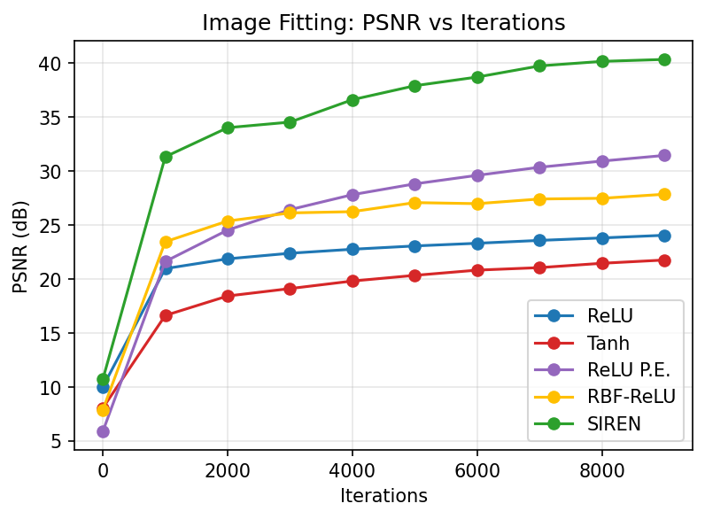
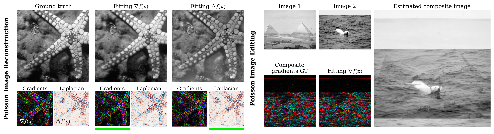

# SIREN Reproduction on Google Colab

A reproduction of **Implicit Neural Representations with Periodic Activation Functions** (SIREN, Sitzmann et al., NeurIPS 2020) using the [official code](https://github.com/vsitzmann/siren), run end to end on Google Colab.

All four main-paper figures were reproduced: image fitting (Fig. 1), video fitting (Fig. 2), Poisson image reconstruction and editing (Fig. 3), and shape representation with signed distance functions (Fig. 4). Training used the official scripts and their default settings; every change needed to run them on Colab is listed under [Deviations from the official setup](#deviations-from-the-official-setup).

## Results

### Fig. 1 — Image fitting

Five architectures fit the cameraman image: ReLU, Tanh, ReLU with positional encoding, RBF-ReLU and SIREN. Rows show the reconstruction, its gradient and its Laplacian. SIREN reproduces both the image and its derivatives; the baselines lose fine detail and produce noisy or empty second derivatives, as in the paper.


PSNR during training:



### Fig. 2 — Video fitting

SIREN and a ReLU MLP fit the cat video (512 × 512, 300 frames) with the official defaults (100,000 epochs). Final training PSNR:

| Model | Ours (dB) | Paper (dB) |
|---|---|---|
| SIREN | 32.07 | 29.90 |
| ReLU | 25.36 | 25.12 |

SIREN beats ReLU by a margin close to the paper's.

**SIREN** (top: ground truth, bottom: prediction)


**ReLU** (top: ground truth, bottom: prediction)


### Fig. 3 — Poisson image reconstruction and editing

Left: a SIREN supervised only by the image's gradients (Fitting ∇f) or only by its Laplacian (Fitting Δf); the green bar marks the supervised quantity. Right: the gradients of two images are averaged and a SIREN fits the composite gradients. All panels are the images written by the official TensorBoard summary functions, placed in the paper's layout.



### Fig. 4 — Shape representation (SDF)

SDFs fitted directly on oriented point clouds of the Thai statue and a living room, meshes extracted at 1600³. Left: close-up and full view of the statue. Right: the room. ReLU and SIREN are rendered with identical cameras and lighting. SIREN recovers the carved faces and the furniture; ReLU produces blobby, faceted surfaces.


## Training logs

The original TensorBoard event files are 0.1–2.5 GB each, because the official summaries store full images and video frames, so they are not in this repository. Each experiment folder instead keeps:

- `scalars.csv`: every logged scalar (losses, PSNR) at every logged step. For the longest runs it is stored gzip-compressed as `scalars.csv.gz` to stay under GitHub's 100 MB file limit; read it directly with `pandas.read_csv("scalars.csv.gz")`.
- `tensorboard_scalars/`: the same scalars as a small TensorBoard log. For the longest runs only every N-th step (plus the last step) is kept here; the CSV always has every step. View all runs with:
  ```bash
  tensorboard --logdir logs
  ```
- `final_images/`: the last image logged for each image tag.
- `model_final.pth`: the final weights, loadable with the official `modules.SingleBVPNet`.
- `train_losses_final.txt`: the official loss record, where present.

Final value of every logged scalar:

| Experiment | Tag | Final step | Final value |
|---|---|---|---|
| `poisson_comp` | `gradients_loss` | 9999 | 0.0153353 |
| `poisson_comp` | `total_train_loss` | 9999 | 0.0153353 |
| `poisson_comp_v2` | `gradients_loss` | 9999 | 0.00912066 |
| `poisson_comp_v2` | `total_train_loss` | 9999 | 0.00912066 |
| `poisson_grad` | `gradients_loss` | 9999 | 0.33178 |
| `poisson_grad` | `total_train_loss` | 9999 | 0.33178 |
| `poisson_lapl` | `laplace_loss` | 9999 | 1148.32 |
| `poisson_lapl` | `total_train_loss` | 9999 | 1148.32 |
| `sdf_room_relu` | `grad_constraint` | 409999 | 6.85711 |
| `sdf_room_relu` | `inter` | 409999 | 3.6616 |
| `sdf_room_relu` | `normal_constraint` | 409999 | 10.7895 |
| `sdf_room_relu` | `sdf` | 409999 | 1.67635 |
| `sdf_room_relu` | `total_train_loss` | 409999 | 22.9845 |
| `sdf_room_sine` | `grad_constraint` | 261000 | 3.06002 |
| `sdf_room_sine` | `inter` | 261000 | 3.41666 |
| `sdf_room_sine` | `normal_constraint` | 261000 | 6.26108 |
| `sdf_room_sine` | `sdf` | 261000 | 1.36987 |
| `sdf_room_sine` | `total_train_loss` | 261000 | 14.1076 |
| `sdf_room_sine_resume` | `grad_constraint` | 151699 | 2.65701 |
| `sdf_room_sine_resume` | `inter` | 151699 | 3.44697 |
| `sdf_room_sine_resume` | `normal_constraint` | 151699 | 6.00983 |
| `sdf_room_sine_resume` | `sdf` | 151699 | 1.01309 |
| `sdf_room_sine_resume` | `total_train_loss` | 151699 | 13.1269 |
| `sdf_thai_relu` | `grad_constraint` | 189999 | 25.1222 |
| `sdf_thai_relu` | `inter` | 189999 | 0.945386 |
| `sdf_thai_relu` | `normal_constraint` | 189999 | 44.1835 |
| `sdf_thai_relu` | `sdf` | 189999 | 0.0474918 |
| `sdf_thai_relu` | `total_train_loss` | 189999 | 70.2986 |
| `sdf_thai_sine` | `grad_constraint` | 189999 | 2.51263 |
| `sdf_thai_sine` | `inter` | 189999 | 0.604496 |
| `sdf_thai_sine` | `normal_constraint` | 189999 | 2.01361 |
| `sdf_thai_sine` | `sdf` | 189999 | 1.3058 |
| `sdf_thai_sine` | `total_train_loss` | 189999 | 6.43654 |
| `video_cat_relu` | `img_loss` | 99999 | 0.0116586 |
| `video_cat_relu` | `total_train_loss` | 99999 | 0.0116586 |
| `video_cat_relu` | `train_psnr` | 99900 | 25.365 |
| `video_cat_sine` | `img_loss` | 99999 | 0.00274661 |
| `video_cat_sine` | `total_train_loss` | 99999 | 0.00274661 |
| `video_cat_sine` | `train_psnr` | 99900 | 32.0658 |

## Repository structure

```text
.
├── README.md
├── SIREN_1.ipynb          # Colab notebook: every step, with a description under each cell
├── figures/               # reproduced Fig. 1–4 and the PSNR curve
└── logs/                  # one folder per experiment
    ├── poisson_comp/
    ├── poisson_comp_v2/
    ├── poisson_grad/
    ├── poisson_lapl/
    ├── sdf_room_relu/
    ├── sdf_room_sine/
    ├── sdf_room_sine_resume/
    ├── sdf_thai_relu/
    ├── sdf_thai_sine/
    ├── video_cat_relu/
    └── video_cat_sine/
```

## How to reproduce

1. Open `SIREN_1.ipynb` in Google Colab and select a GPU runtime.
2. Run the cells in order. Each cell has a short description below it. Logs are written to `MyDrive/siren_reproduction/logs`, so a disconnect does not lose finished runs.
3. Approximate training time on one GPU: image fitting a few minutes per model; video about 4 h per model; SDF about 4.4 h per statue model and 9.5 h per room model (about 12 steps/s).

## Deviations from the official setup

None of these change the model architectures, losses or optimizer.

**Environment fixes**
- Installed the packages the scripts import that Colab lacks (`cmapy`, `scikit-video`, `configargparse`, etc.) instead of the conda `environment.yml`.
- Patched the installed `scikit-video` to replace `np.int` / `np.float` / `np.bool`, which current NumPy removed.
- In `sdf_meshing.py`, replaced `skimage.measure.marching_cubes_lewiner` (removed in scikit-image 0.19) with `marching_cubes`. Its default method is Lewiner, so extracted meshes are unchanged.
- Some script names and paths differ from the README (`train_sdf.py` / `test_sdf.py`, `train_poisson_lapl_img.py`); hard-coded paths to the authors' machines were redirected to local files.

**Data**
- Video: the cat video from the authors' shared data folder.
- Poisson reconstruction: BSDS500 training image index 19 (the starfish), as in the official script.
- Poisson editing: the authors' `gizeh.jpg` and `bear.jpg` are not public. We used [Pyramids of Geezeh](https://commons.wikimedia.org/wiki/File:Pyramids_of_Geezeh.jpg) (public domain) and [Polar bear arctic](https://commons.wikimedia.org/wiki/File:Polar_bear_arctic.JPG) by Brocken Inaglory (see its Commons page for the license), resized to the sizes the code expects. The bear was cut out with `rembg` and placed on a background matching the code's padding gray (0.85).
- SDF: `thai_statue.xyz` and `interior_room.xyz` from the authors' shared data folder.

**Training**
- SDF: `batch_size=250000` as given in the official README. `epochs_til_ckpt` was raised from 1 to 100 to avoid writing 10,000 checkpoints; this affects only how often weights are saved.
- SDF room network width: the paper's supplement states 1024 units per layer for the room, but the official `train_sdf.py` builds the default 256-unit network with no option to change it. Both room models here are 256 wide, following the official code.
- SDF training length: 10,000 epochs (the script default) equals about 190k steps for the statue and 410k for the room, longer than the 50,000 iterations in the supplement.
- The room SIREN run was interrupted and resumed from its last checkpoint (`sdf_room_sine` → `sdf_room_sine_resume`). The official code saves only model weights, so the Adam optimizer state was reset at the resume point.

**Figures**
- Fig. 1 logs were written to the Colab instance's local disk and were lost when the session ended; only the generated figures are kept.
- Fig. 4: the repository contains no rendering code, and the paper does not describe its renderer or cameras (the README suggests viewing meshes in MeshLab). Meshes were rendered with pyrender, and cameras were aligned by hand to the paper's figure.

## Not included

- The full TensorBoard event files and intermediate checkpoints (over 10 GB in total).
- The extracted meshes (`test.ply`, 150–830 MB each), which exceed GitHub's file size limit.

## Reference

```bibtex
@inproceedings{sitzmann2020siren,
  author    = {Sitzmann, Vincent and Martel, Julien N. P. and Bergman, Alexander W. and Lindell, David B. and Wetzstein, Gordon},
  title     = {Implicit Neural Representations with Periodic Activation Functions},
  booktitle = {Advances in Neural Information Processing Systems (NeurIPS)},
  year      = {2020}
}
```

All code is from the [official SIREN repository](https://github.com/vsitzmann/siren) (MIT license); this repository adds only the Colab notebook, logs and figures.
